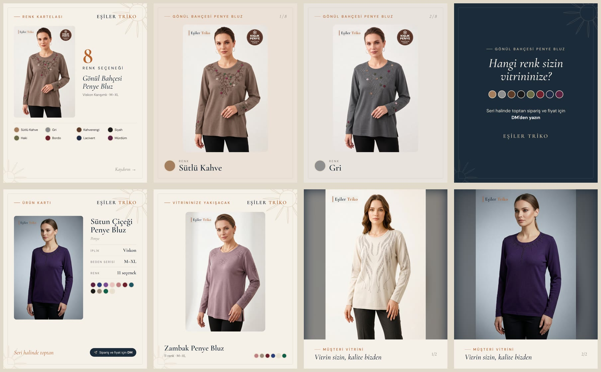
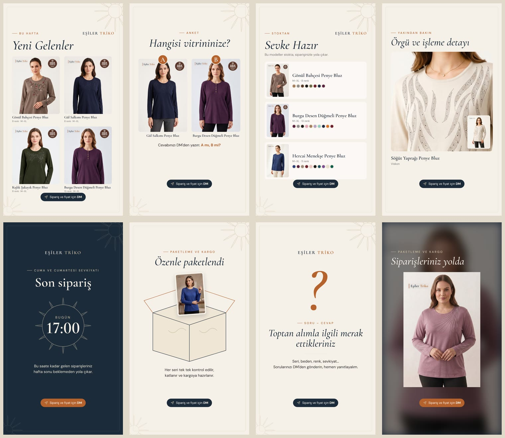

# Eşiler Triko: Otomatik Instagram + Facebook Paylaşımı

Haftalık takvime göre görselleri ve videoları kendisi üretir, açıklamalarını yazar ve Instagram hesabı ile Facebook sayfasına paylaşır. Ücretli hiçbir servis kullanmaz:

| İş | Ücretsiz araç |
|---|---|
| Zamanlama ve çalıştırma | GitHub Actions (public repoda dakika sınırı yok) |
| Görsel ve video üretimi | Remotion (3 kişiye kadar şirketlerde ücretsiz), FFmpeg |
| Telefondan medya ekleme | Google Drive klasörü (service account ile okunur) |
| Medyanın herkese açık adresi | GitHub Pages (`media` dalı) |
| Yayın | Meta Graph API (v26.0) |
| Açıklamalar | Şablon tabanlı, dönüşümlü Türkçe metinler (yapay zekâ servisi yok) |

**Örnek çıktılar:** [`samples/`](samples/) klasöründe her şablondan bir örnek var (videolar ve açıklama metinleri dahil). `-yedek` ekli dosyalar Drive'da gerçek çekim yokken üretilen içeriklerdir. `-gercek` ekli dosyalar gerçek çekim şablonlarıdır; bu örneklerde gerçek çekim yerine ürün fotoğrafları kullanıldı.




---

## İçindekiler

1. [Nasıl çalışır](#nasıl-çalışır)
2. [Kurulum özeti](#kurulum-özeti)
3. [Meta: System User token](#1-meta-system-user-token)
4. [FB_PAGE_ID ve IG_USER_ID nasıl bulunur](#2-fb_page_id-ve-ig_user_id-nasıl-bulunur)
5. [Google Drive kurulumu](#3-google-drive-kurulumu)
6. [Secrets ekleme](#4-secrets-ekleme)
7. [GitHub Pages](#5-github-pages)
8. [DRY_RUN ile test](#6-dry_run-ile-test)
9. [Canlıya geçiş](#7-canlıya-geçiş)
10. [products.yaml düzenleme](#productsyaml-düzenleme)
11. [brand.yaml düzenleme](#brandyaml-düzenleme)
12. [Takvimi değiştirme](#takvimi-değiştirme)
13. [Açıklama metinleri](#açıklama-metinleri)
14. [Haftalık önizleme](#haftalık-önizleme)
15. [Sınırlar ve bilinmesi gerekenler](#sınırlar-ve-bilinmesi-gerekenler)
16. [Render motoru ve Remotion lisansı](#render-motoru-ve-remotion-lisansı)
17. [Yerelde çalıştırma](#yerelde-çalıştırma)

---

## Nasıl çalışır

```
her 15 dk (GitHub Actions)
  └─ check: zamanı gelmiş, paylaşılmamış slot var mı?  (yoksa ~30 sn'de biter)
      └─ run-due
          ├─ plan: hangi ürün? (aynı ürün 14 gün içinde tekrar öne çıkmaz)
          ├─ medya: Drive'daki yeni foto/video (yoksa ürün bazlı yedek + uyarı)
          ├─ render: Remotion ile JPEG / MP4
          ├─ yükle: GitHub Pages (media dalı) → herkese açık URL
          ├─ yayınla: Instagram ve Facebook (biri hata verirse diğeri yine paylaşır)
          └─ state/posted_state.json'a yaz ve commit et (tekrar paylaşım olmaz)
```

- **Gecikme:** GitHub'ın cron'u yoğun saatlerde 5–30 dk gecikebilir. İçerik atlanmaz, tetiklendiği anda paylaşılır. İstenirse `schedule.yaml`'daki `en_fazla_gecikme_saat` ile sınır konabilir.
- **Tekrar paylaşım koruması:** Her başarılı paylaşım anında `state/posted_state.json`'a yazılıp repo'ya gönderilir. İş yarıda kesilse bile aynı içerik iki kez paylaşılmaz.
- **Hata:** Bir kanal hata verirse sonraki çalıştırmalarda yeniden denenir. 8 başarısız denemeden sonra o slot o kanalda bırakılır. Hatalar Actions özet ekranında kırmızı görünür ve GitHub e-posta ile bildirir.
- **İlk canlı çalıştırma:** O anın zamanını `yayin_baslangic` olarak kaydeder. Daha önceki slotlar geriye dönük paylaşılmaz.

### İçerik tipleri

| Gün / saat | Tür | İçerik | Kaynak |
|---|---|---|---|
| Pzt 08:30 | Hikâye | Haftanın yeni gelenleri | `products.yaml`'daki ilk 4 ürün |
| Pzt 12:30 | Carousel | Renk kartelası (kapak + her renk + kapanış) | 1 ürün, rotasyonlu |
| Pzt 16:30 | Hikâye | Anket görseli: "Hangisi vitrininize? A mı B mi?" | 2 ürün |
| Sal 09:00 | Hikâye | Sevke hazır stok | `sevke_hazir: true` ürünler, sırayla 3'er |
| Sal 15:30 | Reels | Atölyeden: iplikten pakete | Drive `atolye/` videoları · yoksa YEDEK |
| Çar 08:30 | Hikâye | Örgü dokusu yakın çekim | Ürün fotoğrafı büyütülür (Drive `doku/` varsa o) |
| Çar 12:30 | Gönderi | Ürün kartı (iplik, gramaj, beden, seri, renk) | 1 ürün |
| Per 13:00 | Hikâye | Cuma–Cumartesi sevkiyatı için son sipariş saati | `schedule.yaml` ayarı |
| Per 15:30 | Reels | Tek model, 5 renk | 1 ürün |
| Cum 10:00 | Gönderi | Müşteri vitrini | Drive `vitrin/` fotoğrafları · yoksa YEDEK |
| Cum 16:00 | Hikâye | Paketleme ve kargo | Drive `paketleme/` video/foto · yoksa YEDEK |
| Cmt 11:00 | Reels | Toptan alımda bilmeniz gereken 3 şey | `egitici.yaml` |
| Cmt 14:00 | Hikâye | Soru-cevap çağrısı | — |

**YEDEK:** Gerçek çekim gerektiren içeriklerde klasörde **yeni** (daha önce kullanılmamış) medya yoksa ürün fotoğraflarından içerik üretilir ve log'a uyarı düşer.

---

## Kurulum özeti

1. Meta'da System User token al → [adım 1](#1-meta-system-user-token)
2. Sayfa ve Instagram kimliklerini bul → [adım 2](#2-fb_page_id-ve-ig_user_id-nasıl-bulunur)
3. Google Drive klasörünü ve service account'u kur → [adım 3](#3-google-drive-kurulumu)
4. GitHub'da Secrets'ları ekle → [adım 4](#4-secrets-ekleme)
5. GitHub Pages'i aç → [adım 5](#5-github-pages)
6. DRY_RUN ile dene → [adım 6](#6-dry_run-ile-test)
7. Canlıya geç → [adım 7](#7-canlıya-geçiş)

---

## 1. Meta: System User token

System User token süresizdir; bir kişinin hesabına bağlı değildir, şifre değişince bozulmaz.

### Ön koşullar

- **Instagram hesabı Profesyonel (İşletme) hesap olmalı:** Instagram → Ayarlar → Hesap türü ve araçlar → Profesyonel hesaba geç → İşletme.
- **Instagram hesabı Facebook sayfasına bağlı olmalı:** Facebook sayfası → Ayarlar → Bağlı hesaplar → Instagram → Bağla.
- **Meta Business portföyü (business.facebook.com):** Yoksa oluşturun. Sayfa ve Instagram hesabı bu portföyde olmalı: *İşletme ayarları → Hesaplar → Sayfalar* ve *Instagram hesapları* → Ekle.

### Uygulama oluşturma

1. developers.facebook.com → **Uygulamalarım → Uygulama oluştur**.
2. Kullanım alanı olarak **Diğer**, uygulama türü olarak **İşletme**'yi seçin. Business portföyünüzü bağlayın.
3. Uygulama panelinde **Ürün ekle** → **Instagram** (Facebook ile giriş üzerinden API kurulumu) ve **Facebook Girişi (İşletmeler için)**.
4. *Uygulama ayarları → Temel*: **Gizlilik politikası URL'si** girin (ör. esiler.com.tr'de bir gizlilik sayfası), kategori seçin, kaydedin.
5. Üst çubuktan uygulamayı **Canlı (Live)** moda alın. Geliştirme modundaki uygulamaların sayfa paylaşımları herkese görünmeyebilir.

### System User ve token

1. business.facebook.com → **İşletme ayarları → Kullanıcılar → Sistem kullanıcıları → Ekle**. Ad: `esiler-bot`, rol: **Yönetici**.
2. Sistem kullanıcısını seçin → **Varlık ata**:
   - **Uygulamalar:** oluşturduğunuz uygulama → *Uygulamayı yönet*.
   - **Sayfalar:** Eşiler Triko sayfası → *İçerik oluştur* dahil tam yetki.
   - **Instagram hesapları:** @esilertriko → tam yetki.
3. **Yeni token oluştur** → uygulamayı seçin → **Süre: Hiçbir zaman (Never)** → şu izinleri işaretleyin:

| İzin | Neden |
|---|---|
| `instagram_basic` | Instagram hesabını okumak |
| `instagram_content_publish` | Gönderi, carousel, Reels, hikâye paylaşmak |
| `pages_show_list` | Sayfayı listelemek, sayfa token'ı almak |
| `pages_read_engagement` | Sayfa içeriğini okumak (paylaşım için zorunlu) |
| `pages_manage_posts` | Sayfaya fotoğraf, Reels, hikâye paylaşmak |
| `business_management` | System User ile çalışmak |
| `ads_read` | Meta dokümanına göre, kullanıcının sayfada Business Manager rolü varsa Instagram paylaşımı için isteniyor |

> Eksik izin olursa paylaşım `(#10) Application does not have permission` ya da `(#200)` hatasıyla düşer. Hata mesajı Actions log'unda ve özet ekranında görünür.

4. Token'ı kopyalayın. Sadece bir kez gösterilir. Bu, `ACCESS_TOKEN` secret'ıdır.

**Kontrol:** developers.facebook.com/tools/debug/accesstoken adresine yapıştırın. *Expires: Never* ve izinler listede görünmeli.

---

## 2. FB_PAGE_ID ve IG_USER_ID nasıl bulunur

**FB_PAGE_ID:**
- Facebook sayfası → **Hakkında → Sayfa şeffaflığı** → *Sayfa kimliği*, ya da
- developers.facebook.com/tools/explorer → token'ı yapıştırın → `GET me/accounts` → sayfanın `id` değeri.

**IG_USER_ID** (Instagram işletme hesabı kimliği; kullanıcı adı değil):
- Graph API Explorer'da: `GET {FB_PAGE_ID}?fields=instagram_business_account` → `instagram_business_account.id` (17 ile başlayan uzun bir sayı).

---

## 3. Google Drive kurulumu

Patron telefondaki Google Drive uygulamasından klasöre fotoğraf ve video yükler; sistem bunları okur.

### Service account (bir kez, bilgisayardan)

1. console.cloud.google.com → yeni proje (ör. `esiler-paylasim`). Faturalandırma **gerekmez**.
2. **API'ler ve Hizmetler → Kitaplık → Google Drive API → Etkinleştir.**
3. **IAM ve Yönetici → Hizmet hesapları → Hizmet hesabı oluştur.** Ad: `esiler-drive`. Rol vermeyin.
4. Hesabı açın → **Anahtarlar → Anahtar ekle → JSON**. İnen dosyanın **tüm içeriği**, `GOOGLE_SERVICE_ACCOUNT_JSON` secret'ıdır.
5. Hesabın e-posta adresini kopyalayın (`esiler-drive@...iam.gserviceaccount.com`).

### Klasör

1. Drive'da `Esiler Paylaşım` adında bir klasör ve içinde şu alt klasörleri oluşturun (adlar birebir aynı olmalı):

```
Esiler Paylaşım/
├─ atolye/       atölye videoları (Salı Reels)
├─ vitrin/       müşteri mağaza fotoğrafları (Cuma gönderisi)
├─ paketleme/    paketleme / kargo foto veya videosu (Cuma hikâyesi)
├─ urunler/      (isteğe bağlı) ürün fotoğrafları; products.yaml'da drive:urunler/... diye kullanılır
└─ doku/         (isteğe bağlı) örgü yakın çekimleri (Çarşamba hikâyesi)
```

2. `Esiler Paylaşım` klasörüne sağ tıklayın → **Paylaş** → service account e-postasını **Görüntüleyen** olarak ekleyin.
3. Klasörü açın; adres çubuğundaki `folders/` sonrasındaki kısım `DRIVE_FOLDER_ID` secret'ıdır.

### Patron için kullanım

- Telefonda Drive uygulaması → `Esiler Paylaşım` → ilgili klasör → **+ → Yükle** → fotoğraf veya video seçin.
- iPhone formatları (HEIC fotoğraf, MOV video) otomatik dönüştürülür.
- Videolar dikey çekilmeli. Her klipten en fazla 5 sn kullanılır, Reels 15–30 sn olur.
- Her medya **bir kez** kullanılır. Eski dosyaları silmek gerekmez ama silinebilir.
- Klasör boşsa o gün ürün bazlı yedek içerik paylaşılır.

> Drive ayarlanmazsa sistem yine çalışır: gerçek çekim içerikleri her zaman yedekle üretilir.

---

## 4. Secrets ekleme

GitHub → repo → **Settings → Secrets and variables → Actions → New repository secret**:

| Secret | Değer |
|---|---|
| `ACCESS_TOKEN` | System User token'ı (adım 1) |
| `FB_PAGE_ID` | Facebook sayfa kimliği (adım 2) |
| `IG_USER_ID` | Instagram işletme hesabı kimliği (adım 2) |
| `GOOGLE_SERVICE_ACCOUNT_JSON` | JSON anahtar dosyasının tüm içeriği (adım 3) |
| `DRIVE_FOLDER_ID` | Drive klasör kimliği (adım 3) |

`GITHUB_TOKEN` otomatik gelir, eklemeyin.

Sadece tek kanal kullanılacaksa ilgili kimliği boş bırakmak yerine `schedule.yaml`'da kanalı kapatın (bkz. [takvim](#takvimi-değiştirme)).

---

## 5. GitHub Pages

Meta, görsel ve videoyu herkese açık bir adresten indirir. Sistem dosyaları `media` dalına koyar, Pages yayınlar.

1. **Settings → Pages → Build and deployment → Source: Deploy from a branch → Branch: `media` / (root) → Save.**
2. `media` dalı yoksa önce [önizleme](#haftalık-önizleme) workflow'unu bir kez elle çalıştırın; dalı o oluşturur.

Adres: `https://<kullanıcı>.github.io/<repo>/`. Dosyalar 7 gün sonra silinir.

---

## 6. DRY_RUN ile test

DRY_RUN modunda her şey üretilir ama **hiçbir şey paylaşılmaz** ve `posted_state.json` değişmez.

**GitHub'da:**
1. **Actions → Paylaşım → Run workflow** → *DRY_RUN* işaretli → **Run**.
2. Son 24 saatin slotları üretilir. Log'da açıklamalar görünür. Görseller ve videolar çalıştırmanın altındaki **Artifacts** bölümünde (`paylasim-...` zip) olur.

**Haftanın tamamını görmek için:** Actions → **Haftalık önizleme** → Run workflow. Gelecek haftanın 13 içeriği görselli bir issue olarak açılır.

**Kalıcı test modu:** Settings → Secrets and variables → Actions → **Variables** → `DRY_RUN` = `true`. Kaldırana kadar hiçbir şey paylaşılmaz.

**Yerelde:**
```bash
npm run run-due -- --dry-run --now=2026-11-02T12:45:00+03:00
```

---

## 7. Canlıya geçiş

1. Secrets eklendi, Pages açık, DRY_RUN çıktıları kontrol edildi.
2. `DRY_RUN` variable'ını silin (veya `false` yapın).
3. Bir sonraki 15 dakikalık çalıştırma `yayin_baslangic` zamanını kaydeder ve o andan sonraki slotlar paylaşılır.

**Durdurmak için:** Actions → Paylaşım → sağ üst **⋯ → Disable workflow**. Ya da `schedule.yaml`'da iki kanalı da `false` yapın.

---

## products.yaml düzenleme

`config/products.yaml` dosyasını GitHub'da açın → kalem simgesi → düzenleyin → **Commit changes**.

```yaml
urunler:
  - id: "938046666"          # değişmeyen benzersiz kimlik (ilk kurulumda Trendyol numarası)
    kod: "ES-1024"           # model kodu; boşsa görünmez
    ad: "Gönül Bahçesi Penye Bluz"   # görsellerde yazan kısa ad
    tam_ad: "..."            # bilgi amaçlı
    kategori: "Penye"
    iplik: "Viskon Karışımlı"
    gramaj: ""               # boşsa ürün kartında satır görünmez
    beden_serisi: "M–XL"
    seri_adedi: ""           # boşsa görünmez
    sevke_hazir: true        # false → "Sevke hazır" hikâyesine girmez
    aktif: true              # false → hiçbir paylaşımda kullanılmaz
    renkler:
      - ad: "Sütlü Kahve"    # brand.yaml → renk_kodlari'nda olmalı
        fotolar:
          - https://cdn.dsmcdn.com/....jpg
          - drive:urunler/ES-1024/sutlu-kahve.jpg   # Drive'dan da olabilir
```

- **Sıralama:** En üstteki ürünler "yeni gelenler"dir. Yeni model en üste eklenir.
- **Fotoğraf:** Her rengin ilk fotoğrafı kullanılır. Ürün fotoğrafları asla kırpılmaz, tamamı görünür.
- **Rotasyon:** Bir ürün öne çıktıktan sonra 14 gün boyunca kartela, ürün kartı, renk Reels'i, doku ve anket içeriklerinde tekrar seçilmez.
- İlk liste, esiler.com.tr'deki Trendyol kataloğundan (27 ürün) oluşturuldu. Model kodu, gramaj ve seri adedi boş; doldurulursa görsellerde ve açıklamalarda otomatik görünür.

## brand.yaml düzenleme

`config/brand.yaml`:

- `whatsapp`: Boş (varsayılan) → görsellerde ve açıklamalarda sadece "Sipariş ve fiyat için DM" yazar. Numara yazılırsa "Sipariş ve fiyat için WhatsApp: … / DM" olur.
- `renkler`: Tüm şablonların renkleri (krem zemin, lacivert, terrakota…).
- `etiketler`: Havuz, Instagram'da min–max etiket sayısı, Facebook'ta etiket sayısı, her zaman eklenecek etiket.
- `renk_kodlari`: Renk adı → renk kodu. Ürüne yeni bir renk adı eklenirse buraya da ekleyin.
- Logo: `assets/logo.png` (şeffaf PNG). Değiştirmek için aynı adla yeni dosya yükleyin.
- Fontlar: Cormorant Garamond ve DM Sans (OFL lisanslı; ğ, ş, ı, İ destekli), `remotion/public/fonts/`.

## Takvimi değiştirme

`config/schedule.yaml`:

```yaml
kanallar:              # ana şalter
  instagram: true
  facebook: true

en_fazla_gecikme_saat: # boş = gecikse de paylaş; 6 yazılırsa 6 saatten eski slot atlanır

tatiller:              # bu günlerde hiç paylaşım yapılmaz
  - "2027-03-20"

slotlar:
  - id: pzt-kartela    # benzersiz ad (değiştirirseniz o slot "yeni" sayılır)
    gun: pazartesi     # pazartesi, sali, carsamba, persembe, cuma, cumartesi, pazar
    saat: "12:30"      # Türkiye saati, tırnak içinde
    tur: carousel      # hikaye | post | carousel | reels
    icerik: renk_kartelasi
    # isteğe bağlı:
    aktif: false                 # slotu kapat
    kanallar: {facebook: false}  # sadece Instagram
    elle: true                   # üret ama paylaşma (elle paylaşmak için)
```

- **Saat değiştirmek:** `saat` değerini değiştirip commit edin. Bir sonraki çalıştırmada geçerli olur.
- **Yeni slot:** Bir bloğu kopyalayıp farklı `id` verin.
- **Son sipariş hikâyesi:** `per-son-siparis` altındaki `ayarlar.baslik` ve `ayarlar.son_saat`.
- **Yeni gelenler adedi:** İlgili slota `ayarlar: {adet: 4}` ekleyin.
- Takvimi kontrol etmek için: `npm run plan` (önümüzdeki 7 gün).

## Açıklama metinleri

- `config/captions.yaml`: Her içerik tipi için dönüşümlü şablonlar. `{ad}`, `{iplik}`, `{beden}`, `{renk_sayisi}`… kullanılabilir. Değeri boş alan içeren satır otomatik silinir. "Sipariş ve fiyat için DM" satırı ve etiketler otomatik eklenir. Hikâyelerde açıklama yoktur.
- `config/egitici.yaml`: Cumartesi eğitici Reels'inin ipucu setleri. Her hafta sıradaki set kullanılır.

## Haftalık önizleme

Her **pazar 14:00**'te gelecek haftanın tüm içerikleri üretilir ve repo'da **görselli bir issue** açılır (GitHub bildirim e-postası gelir). Videolar issue'daki bağlantılardan izlenir; tüm dosyalar ayrıca Artifacts'ta zip olarak durur.

- Önizlemede seçilen ürünler kaydedilir: hafta içinde paylaşılan içerik önizlemedekiyle aynı ürünleri kullanır.
- **YEDEK** işaretli içerikler, paylaşım saatine kadar Drive klasörüne medya eklenirse gerçek çekimle değişir.
- Elle çalıştırmak için: Actions → Haftalık önizleme → Run workflow (*bu hafta* seçeneği de var).

---

## Sınırlar ve bilinmesi gerekenler

- **Anket, geri sayım, soru kutusu çıkartmaları API ile eklenemez.** Bu hikâyeler görsel olarak tasarlandı ve "DM'den yazın" çağrısı içerir. Gerçek çıkartma istenirse slota `elle: true` ekleyin; görsel üretilir, paylaşılmaz, Artifacts'tan alınıp telefondan çıkartmayla paylaşılır.
- **Müzik:** Instagram müzik kütüphanesi API ile kullanılamaz. Videolar varsayılan olarak müziksizdir (sessiz ses izi eklenir). `assets/music/` klasörüne **telif sorunu olmayan** mp3 dosyaları konursa sırayla kullanılır.
- **Instagram hikâyesine açıklama/etiket eklenemez** (API kısıtı).
- **Instagram yalnızca JPEG** kabul eder; tüm görseller JPEG üretilir.
- **Paylaşım sınırları:** Instagram 24 saatte 100 paylaşım, Facebook Reels 24 saatte 30 paylaşım. Bu takvim günde en fazla 3 paylaşım yapar.
- **Video boyutu:** GitHub dosya sınırı 100 MB. 30 sn'lik Reels yaklaşık 10–20 MB tutar.
- **GitHub, 60 gün hiç etkinlik olmayan public repolarda zamanlanmış workflow'ları durdurur.** Sistem her paylaşımda commit attığı için normalde sorun olmaz; durdurulursa Actions sayfasında "Enable workflow" butonuna basın.
- **Facebook hikâyesinde kullanılan medya, aynı sayfada daha önce gönderide kullanılmamış olmalı** (Meta kuralı). Her içerik yeni üretildiği için sorun olmaz.

## Render motoru ve Remotion lisansı

Remotion, **bireyler ve en fazla 3 çalışanı olan şirketler için ücretsizdir**. Eşiler Triko (şahıs şirketi, 2 kişi) bu kapsamda. Şirket büyürse ya Remotion şirket lisansı alınır ya da ücretsiz bir motora geçilir.

Render katmanı soyutlandı ([`src/render/index.ts`](src/render/index.ts)). İçerik üretimi sadece `Renderer` arayüzünü bilir:

```ts
interface Renderer {
  init(): Promise<void>;
  still(job): Promise<void>;  // JPEG
  video(job): Promise<void>;  // H.264 MP4
  close(): Promise<void>;
}
```

Ücretsiz bir motor (ör. Satori + resvg ile görsel, FFmpeg ile video) bu arayüzü uygulayıp `createRenderer()`'a eklenir ve `RENDERER` ortam değişkeniyle seçilir. Şablon verileri (`remotion/types.ts`) motordan bağımsızdır. **Bu ücretsiz motor şu an yazılı değildir**; ihtiyaç olursa eklenir.

## Yerelde çalıştırma

```bash
npm ci
npm run samples                 # her şablondan örnek → samples/
npm run preview -- --this-week  # bu haftanın tüm içerikleri → out/onizleme/
npm run run-due -- --dry-run    # şu an zamanı gelenleri üret (paylaşma)
npm run studio                  # şablonları tarayıcıda canlı düzenle (Remotion Studio)
npm test
```

- Gerekenler: Node 22+, FFmpeg.
- Mac'te Remotion'un headless tarayıcısı çökerse başına `REMOTION_BROWSER="/Applications/Google Chrome.app/Contents/MacOS/Google Chrome"` ekleyin.
- Drive ayarı yokken gerçek çekim klasörleri yerelde `media-local/atolye`, `media-local/vitrin` vb. altında aranır.

### Klasör yapısı

```
config/          schedule.yaml · products.yaml · brand.yaml · captions.yaml · egitici.yaml
assets/          logo.png · music/ · motif/
remotion/        şablonlar: Post.tsx (1080x1350) · Story.tsx (1080x1920) · Video.tsx (Reels)
src/
  cli.ts         komutlar
  runner.ts      zamanı gelenleri bul → üret → yükle → yayınla
  schedule.ts    takvim ve Türkiye saati
  planner.ts     ürün seçimi ve 14 gün kuralı
  content.ts     içerik tipi → şablon + medya + açıklama
  captions.ts    açıklama ve etiketler
  media/         Drive okuma, HEIC/MOV dönüştürme
  render/        Renderer arayüzü + Remotion
  publish/       Instagram · Facebook · GitHub Pages
state/           posted_state.json (paylaşım kayıtları, planlar, rotasyon)
samples/         örnek çıktılar
```
